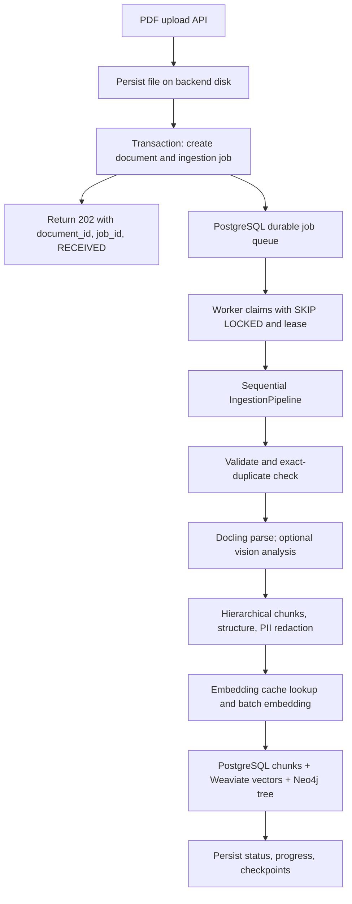
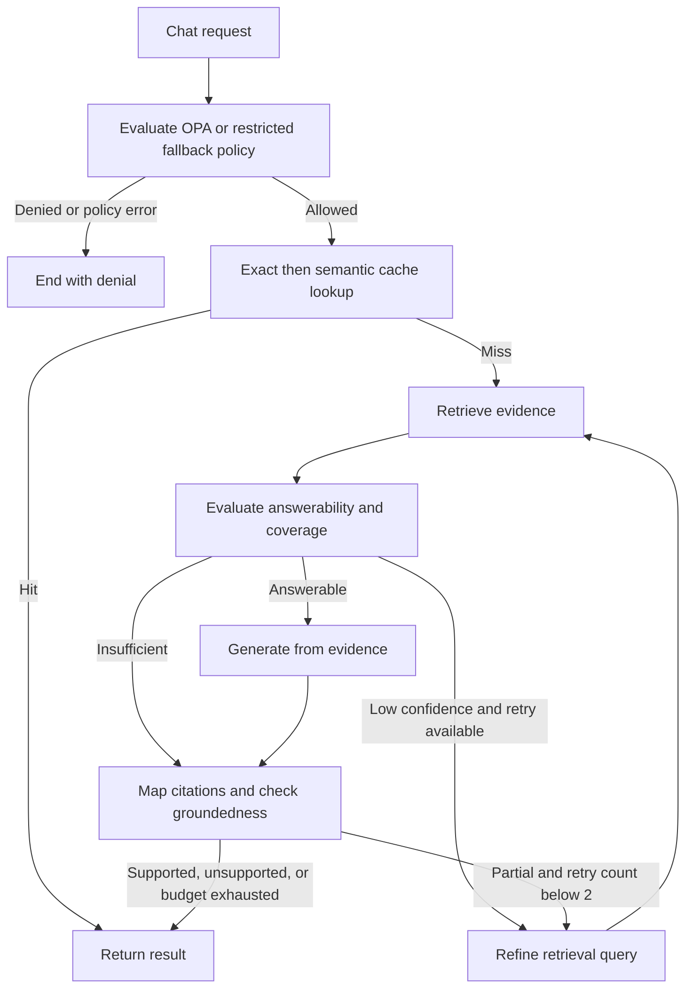

# Enterprise-RAG Architecture

This document describes the implementation in this repository, not a planned
target design. The system is a modular FastAPI application with two separate
workflows: a PostgreSQL-backed ingestion worker and a LangGraph query workflow.
It is not a central autonomous multi-agent router.

## Ingestion lifecycle

`POST /api/v1/documents` writes the uploaded bytes to local storage and then
registers the document and job in one PostgreSQL transaction. PostgreSQL supplies
their UUIDs. The response follows disk I/O and database work; no fixed latency is
promised. A background `asyncio` task polls PostgreSQL; there is no in-memory
`asyncio.Queue` as the source of truth.

The worker claims jobs with `FOR UPDATE SKIP LOCKED`, increments the attempt
count, and records a renewable lease. A heartbeat extends that lease during the
pipeline. The configured attempt limit defaults to three. A crashed worker's
expired lease can be reclaimed; an exhausted job is marked failed.

`IngestionPipeline` runs validation, duplicate detection, parsing, vision,
chunking, incremental chunk comparison, metadata, embedding, and indexing in
order. It writes stage status/progress and checkpoints to PostgreSQL. Progress
values are stage markers, not fine-grained percentages. On restart, the
intermediate parsed documents, chunks, and vectors are not reconstructed from
checkpoint data, so a replay starts at the beginning.

Exact raw-file duplicates are detected by SHA-256 within a tenant and knowledge
base. Chunk hashes identify reusable content, while embedding cache hits keyed
by content hash and embedding-model version avoid recomputing vectors. The
document version/supersedes fields and higher-level near-duplicate/version
classification are not fully wired into this pipeline.

The index step writes chunk metadata to PostgreSQL, vectors to Weaviate, and
document hierarchy to Neo4j. PostgreSQL uses conflict handling, Weaviate uses
deterministic chunk UUIDs, and Neo4j uses merge semantics for retry-safe writes.
If only some stores succeed, the job is marked partial and retried; successful
writes invalidate the knowledge-base cache version.

Docling extracts text, tables, and figure references, with a PyMuPDF fallback.
Parser profile selection is partly filename-based. OCR is not a separate
pipeline stage: a separate `OCRService` is constructed but not called by the
steps. Generic scanned PDFs are therefore not guaranteed to receive OCR.
Figure analysis is disabled by default; enabling Gemini vision requires an
external API key. Tables and figures are represented in chunks when parsing
extracts them.

## Query lifecycle

The chat route creates `QueryNodes`, builds a LangGraph, and invokes it with the
tenant context and initial query state. `evaluate_policy` calls OPA and supplies
permitted access levels. If `OPA_ENABLED=false`, the policy client instead
requires an authenticated identity bound to the tenant and an explicitly
authorized knowledge base, then permits only `PUBLIC` retrieval reads; other
actions are denied. Images are unavailable in this mode. Health reports
`OPA_DISABLED_PUBLIC_ONLY` and `limited`, not full OPA protection.
`check_cache` looks for an exact response and then a semantic response. A cache
hit terminates the graph; lookup failures are logged and treated as misses.

`retrieve_evidence` calls `RetrievalAgent` with the original or refined retrieval
query. `check_answerability` uses `EvidenceCoverageService`; insufficient
evidence becomes a refusal without an LLM call. Low confidence permits one
refinement. `refine_query` increments the shared retry count and appends a fixed
retrieval suffix; it does not rewrite the user's original question. `generate_response`
uses the original query and selected evidence. `verify_citations` maps citations
only to supporting chunk IDs and checks the generated answer against evidence.
Partial verification may retry while the shared retry count is below two, so
the graph is bounded to at most three retrieval/generation passes.

The `/api/v1/search` and diagnostic query routes can execute retrieval directly
without the chat graph, but they evaluate the same OPA retrieval policy.

## Retrieval and evidence

`RetrievalAgent` normalizes the query and derives intent, entities, morphological
and typo variants. Structural count/list/page-format intents can use the
PostgreSQL document-structure index when the access policy permits it. Otherwise
the agent starts dense Weaviate and BM25 searches in parallel, adds separate
morphological/typo BM25 lists when applicable, and may add graph search for
relationship-oriented intents.

Comparison, relationship, symbol-purpose, and multi-hop query forms can be
decomposed using structural patterns; decomposition is not an LLM planning call.
Subquery dense/BM25 lists join the full-query lists. Reciprocal Rank Fusion uses
`score(d) = sum(1 / (60 + rank_i(d)))`. Candidates are deduplicated by chunk ID,
reranked against the original query and subqueries using the
`cross-encoder/ms-marco-MiniLM-L-6-v2` model when available, selected with
subquery/source diversity, expanded to parent chunks, and confidence-scored.
If the cross-encoder is unavailable, the service logs and returns the fused
ordering.

Tenant ID, knowledge-base ID, and OPA-permitted classification levels are passed
into the dense, keyword, and graph data lookups. Graph matches are subsequently
loaded from PostgreSQL with the same access filters. The graph path currently
matches hierarchy/entity-associated chunk IDs; it is not a general,
unbounded multi-hop reasoning engine.

There is no hardcoded number of manuals. A relationship query naming four
systems may produce four subject subqueries; the global ranked lists are fused
and selected together. Final evidence is still bounded by `top_k` and the
generation context budget, so a top-k smaller than the number of requirements
cannot guarantee one result for every requirement.

The selected chunks are formatted with file, page, and section labels, up to
three chunks per source where possible, and bounded by configurable character
and token budgets. The system prompt instructs the LLM to use only retrieved
evidence. The groundedness verifier uses lexical token overlap per sentence,
not semantic entailment; it is a useful heuristic, not a guarantee of factuality.

## Agents, state, and external services

- `IngestionSupervisor` accepts uploads, claims durable jobs, maintains leases,
  and runs `IngestionPipeline`.
- `IngestionAgent` is a placeholder whose parser/chunk strategy methods return
  fixed defaults; the pipeline does not use it to make decisions.
- `QueryNodes` are deterministic LangGraph steps. `RetrievalAgent` orchestrates
  specialized search, fusion, reranking, and expansion services.
- `QueryWorkflowState` is a mutable `TypedDict` shared and updated by graph
  nodes. `QueryState` and `IngestionState` are Pydantic models generally passed
  forward with `model_copy`; nested payloads may still be mutable.

Render requires separately hosted PostgreSQL, Weaviate, Neo4j, and Groq
services. OPA is required for normal policy enforcement; a temporary
`OPA_ENABLED=false` mode is limited to authenticated, tenant/knowledge-base
scoped `PUBLIC` retrieval and denies image access. Redis is optional. Ollama's
localhost fallback is not available in a Render container unless an external
Ollama host is configured. Uploaded files are on the backend's persistent
disk; separate Render instances do not share that disk, so multiple workers
need shared object storage. See
[`production_runbook.md`](./production_runbook.md) for deployment settings and
operational limitations.
