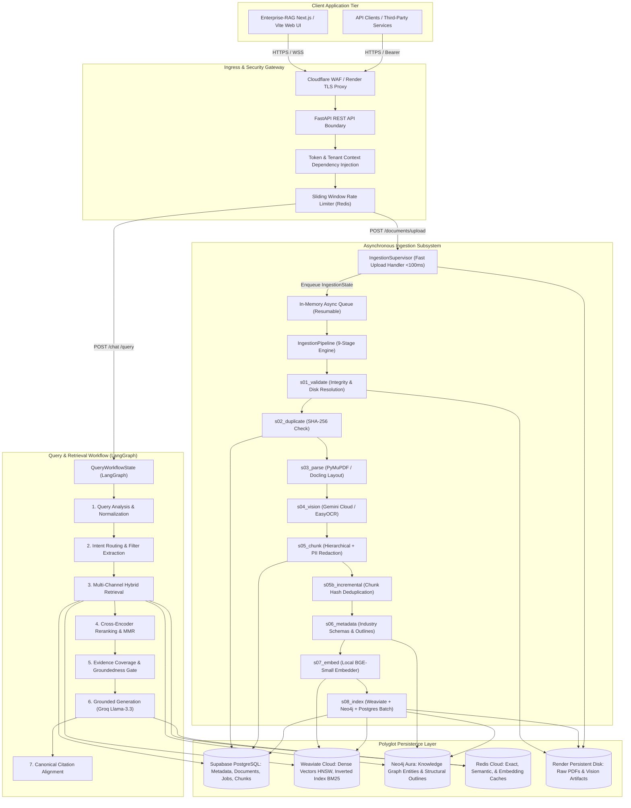

# Enterprise-RAG System Architecture & Component Specification

**Date:** 2026-10-22  
**Platform:** Enterprise-RAG Multimodal Industrial RAG Platform  
**Architecture Style:** Event-Driven Micro-Modular Monolith with Distributed Polyglot Persistence  
**Target Environments:** Cloud PaaS (Render, Supabase, Weaviate Cloud, Neo4j Aura, Redis Cloud) & On-Premises Air-Gapped Deployments

---

## 1. High-Level System Architecture

Enterprise-RAG is organized into two primary asynchronous processing pathways:
1. **Asynchronous Multi-Stage Ingestion Pipeline (Slow Path / Batch):** Receives complex engineering documents (PDFs, schematics, service manuals), parses layout geometries, executes OCR, categorizes technical metadata, generates local dense embeddings, and populates the polyglot persistence tier.
2. **Low-Latency Conversational Query Engine (Fast Path / Interactive):** Orchestrated via LangGraph stateful workflows, combining query analysis, multi-tenant policy evaluation, hybrid retrieval (Dense + Sparse + Graph), Cross-Encoder reranking, factual evidence verification, and grounded generation with token-level source attribution.

---

## 2. Core Subsystems Detailed Breakdown

### 2.1 Ingestion Supervisor & Pipeline Engine
- **Fast Upload Handler (`supervisor/agent.py`):**
  - Guarantees `<100ms` API response times for file uploads.
  - Verifies physical disk presence, inserts records into `documents` and `ingestion_jobs` tables with `status = 'RECEIVED'`, and immediately returns `{document_id, job_id, status: 'RECEIVED'}`.
  - Resilient restart recovery: on service startup, checks for interrupted documents (`status IN ('PENDING', 'PROCESSING', 'CHUNKING')`) and requeues them automatically.
- **Sequential Pipeline (`pipeline.py`):**
  - Executes 9 distinct stages with bounded timeouts (`asyncio.wait_for`) and database checkpoint persistence after every stage.
  - Stage resumability: If a job fails at Step 7, upon restart it resumes directly from Step 7 without re-running parsing or OCR.
  - Short-circuit deduplication: If a duplicate file is detected in Step 2, the pipeline completes immediately without redundant embedding or indexing compute.

### 2.2 Hierarchical Chunking & PII Protection
- **Hierarchical Chunk Model:**
  - Chunks maintain dual granularity: large **Parent Chunks** (~1000 tokens) preserving overarching semantic narrative and tables, and small **Child Chunks** (~250 tokens) targeted for dense vector similarity.
  - Child vectors indexed in Weaviate; upon vector match, parent chunks are fetched from PostgreSQL to populate generation context.
- **Inline PII Protection:**
  - `SimpleRegexPIIDetector` redacts emails, telephone numbers, and SSNs before vectors are computed and before text is persisted in searchable indexes.

### 2.3 Hybrid Retrieval & Reranking Architecture
- **Dense Vector Search:**
  - 384-dimensional embeddings generated locally via `BAAI/bge-small-en-v1.5` on CPU/GPU.
  - Vectors indexed in Weaviate Cloud using HNSW with Cosine distance metric.
- **Sparse BM25 Search:**
  - Weaviate native inverted index search over technical tokens, error codes, and equipment part numbers.
- **Knowledge Graph Traversal:**
  - Neo4j graph stores hierarchical document outlines (`Document` $\rightarrow$ `Section` $\rightarrow$ `Subsection` $\rightarrow$ `Chunk`) and domain entities (`System` $\rightarrow$ `Component` $\rightarrow$ `Specification`).
  - Graph queries retrieve sibling chunks and structural diagrams related to retrieved components.
- **Reciprocal Rank Fusion (RRF) & Cross-Encoder Reranking:**
  - Merges dense, sparse, and graph candidate lists using canonical RRF ($k=60$).
  - Top-50 fused candidates re-scored via `ms-marco-MiniLM-L-6-v2` cross-encoder to produce the definitive top-10 evidence chunks.

### 2.4 Guardrails, Hallucination Prevention & Generation
- **Evidence Coverage Analysis (`coverage.py`):**
  - Evaluates whether retrieved evidence actually mentions the entities and relationships queried. If insufficient, triggers truthful abstention instead of speculative generation.
- **Groundedness Verification (`hallucination.py`):**
  - Measures lexical n-gram overlap between generated answer and retrieved evidence chunks.
  - Categorizes confidence into `HIGH` ($\ge 0.60$), `MEDIUM` ($0.35 - 0.59$), or `LOW` ($< 0.35$).
- **Granular Citation Attribution (`citations.py`):**
  - Maps every factual assertion to an exact document ID, page number, canonical section title, and verbatim evidence snippet.

---

## 3. Data Storage & Schema Design

### 3.1 Supabase PostgreSQL
- **`documents`:** Master document catalog (`id`, `sha256`, `file_name`, `storage_path`, `industry`, `tenant_id`, `status`, `embedding_model`, `created_at`).
- **`ingestion_jobs`:** Background job lifecycle (`job_id`, `document_id`, `status`, `progress`, `current_stage`, `stage_checkpoints`, `started_at`, `completed_at`, `error_message`).
- **`chunks`:** Relational chunk metadata (`chunk_id`, `parent_id`, `document_id`, `content`, `page_number`, `section`, `section_number`, `tenant_id`, `access_classification`).

### 3.2 Weaviate Cloud (Collection: `DocumentChunk`)
- **Vector:** 384 dimensions (`BAAI/bge-small-en-v1.5`).
- **Properties:** `chunk_id`, `document_id`, `tenant_id`, `access_classification`, `content`, `section`, `page_number`, `content_hash`.
- **Index:** HNSW with cosine distance + inverted BM25 index on text properties.

### 3.3 Redis Cloud
- **Exact Cache:** Key `rag:{tenant_id}:{kb_version}:exact:{query_hash}` $\rightarrow$ Cached `QueryResponse`.
- **Semantic Cache:** Key `rag:{tenant_id}:{kb_version}:semantic:...` $\rightarrow$ Cosine similarity lookup ($\ge 0.96$ threshold).
- **Rate Limiting:** Sliding window zset `ratelimit:{tenant_id}:{window}`.
