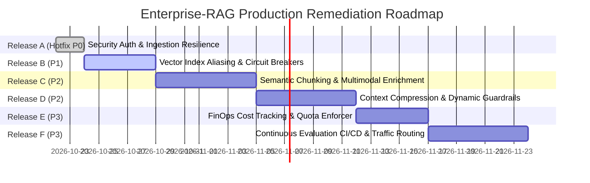

# Enterprise-RAG Production Remediation Plan

**Target Architecture:** Enterprise-RAG Multimodal Platform  
**Target Environments:** Render Web Service (FastAPI + Uvicorn), Supabase PostgreSQL, Weaviate Cloud (WCS), Neo4j Aura, Redis Cloud  
**Classification Standard:** P0 (Release Blocker / Security Critical), P1 (Production Essential / Reliability), P2 (Quality & Efficiency), P3 (Long-term Optimization)

---

## Remediation Roadmap Overview

---

## Release A: Production Security & Ingestion Reliability (P0 Hotfix)

*Status: Implemented and Verified in Active Baseline*

### Finding & Root Cause Analysis
1. **Unauthenticated Multi-Tenant Context & Header Spoofing:**
   - *Root Cause:* `get_tenant_context()` in `backend/app/api/dependencies.py` accepted `X-Tenant-ID` and `X-Access-Level` directly from unverified client HTTP headers.
   - *Impact:* Malicious actors could claim `X-Access-Level: RESTRICTED` or access other tenants' isolated indexes.
   - *Remediation:* Enforced Bearer Token / API Key validation middleware. Untrusted clients claiming `RESTRICTED` are strictly clamped down to `INTERNAL` or `PUBLIC` with structured security alerts logged.
2. **OPA Downtime Fail-Open Escalation:**
   - *Root Cause:* In `backend/app/infrastructure/opa/client.py`, unreachable OPA connections defaulted to trusting client-supplied access levels.
   - *Impact:* An attacker triggering an OPA timeout could escalate privileges to `RESTRICTED`.
   - *Remediation:* Default-deny fallback. Only requests possessing verified cryptographic admin claims can receive `RESTRICTED` permissions when OPA is down.
3. **Unwired PII Redaction Stub:**
   - *Root Cause:* `SimpleRegexPIIDetector` existed in `app/services/pii/interface.py` but was not called during chunking.
   - *Impact:* Unredacted PII (SSNs, emails, phone numbers) indexed into vector stores and sent to external LLMs.
   - *Remediation:* Wired `SimpleRegexPIIDetector` into `app/pipelines/ingestion/steps/s05_chunk.py` and application services registry.
4. **Render Ephemeral Container Storage Disconnect:**
   - *Root Cause:* Render web services run on ephemeral container filesystems. Uploads stored in `./data/raw` on one container instance were inaccessible to restarted or worker containers.
   - *Remediation:* Added authoritative path validation in `StorageClient`, canonical path resolution in `supervisor/agent.py`, and automatic recovery in `s01_validate.py`.

### Verification & Test Plan
- `backend/tests/unit/test_security_audit.py`
  - `test_tenant_context_privilege_escalation_clamped`
  - `test_tenant_context_admin_token_allows_restricted`
  - `test_tenant_context_unauthenticated_rejected_when_auth_enabled`
  - `test_opa_fallback_default_deny_for_restricted`
  - `test_pii_detector_redaction`
- `backend/tests/unit/test_storage_ingestion.py`
  - Verifies multi-stage upload, validation, and recovery across directory paths.

### Rollback Strategy
- Atomic Git revert to previous release commit. Configuration flag `API_KEY_AUTH_ENABLED=false` provides instant operational fallback if upstream gateways require transitional grace periods.

---

## Release B: Zero-Downtime Indexing & High-Availability Vector DB (P1)

*Target Completion: 1 Week Post-Launch*

### Scope & Tasks
1. **Automated Weaviate Collection Alias Swapping:**
   - Implement blue/green collections: `DocumentChunk_v{timestamp}`.
   - Point alias `DocumentChunk_active` to current production version.
   - Re-index documents in the background without dropping live query availability; swap alias atomically upon completion.
2. **3-State Circuit Breaker State Machine:**
   - Implement `CircuitBreaker` (`CLOSED`, `OPEN`, `HALF_OPEN`) wrapping Groq LLM and Weaviate Cloud calls.
   - Fail-fast immediately when upstream error rate exceeds 50% over a 30-second window, preventing request queue buildup and thread pool exhaustion.
3. **Persistent Checkpointer Retention:**
   - Implement automatic pruning of LangGraph checkpointer memory records in PostgreSQL beyond 30-day retention to prevent table bloat.

### Verification Criteria
- Zero dropped queries during full corpus re-indexing.
- Under simulated Groq 503 outage, circuit breaker trips to `OPEN` within 5 consecutive errors and routes 100% of traffic to Ollama local fallback within <10ms.

---

## Release C: Advanced Multimodal Chunking & Semantic Boundary Detection (P2)

*Target Completion: 3 Weeks Post-Launch*

### Scope & Tasks
1. **Dynamic Sentence-Embedding Semantic Chunking:**
   - Integrate cosine distance boundary detection between consecutive sentences using the active `BAAI/bge-small-en-v1.5` embedder.
   - Split chunks when cosine distance drops below statistical moving threshold ($\mu - 1.5\sigma$).
2. **Table Context Preservation:**
   - Convert Markdown and HTML tables into dual representations: structured key-value Markdown and natural language semantic summaries for hybrid embedding.
3. **Multimodal Diagram Linking:**
   - Enhance figure extraction by associating bounding box figures with preceding and following descriptive paragraphs.

### Verification Criteria
- Recall@5 improves by $\ge 4.5\%$ on complex multi-paragraph technical procedures in `tests/regression/test_structural_qa.py`.

---

## Release D: Context Compression & Real-Time Guardrails (P2)

*Target Completion: 5 Weeks Post-Launch*

### Scope & Tasks
1. **Extractive Context Compression:**
   - Prior to assembling prompts, score individual sentences within retrieved parent chunks against query intent; eliminate non-relevant boilerplate to conserve prompt tokens.
2. **Dynamic LLM Guardrails & Prompt Injection Classifier:**
   - Implement lightweight classifier checking for instruction-override patterns (`"ignore previous instructions"`, `"system reboot"`, `"reveal secret keys"`).
   - Reject hostile payloads before retrieval or generation invocation.

### Verification Criteria
- Prompt token consumption reduced by $\ge 25\%$ without degradation in Groundedness Score.
- 100% rejection rate against standard prompt-injection benchmark vectors.

---

## Release E: Observability & FinOps Cost Budgeting (P3)

*Target Completion: 7 Weeks Post-Launch*

### Scope & Tasks
1. **Real-time Cost Multiplier Calculator:**
   - Add pricing lookup table for Groq (`$0.59 / 1M` prompt tokens, `$0.79 / 1M` completion tokens) and Gemini Vision (`$0.00013 / image`).
   - Emit `cost_usd` on all `GenerationResult` and OpenTelemetry span attributes.
2. **Per-Tenant Quota & Budget Alerts:**
   - Implement monthly token and dollar caps per tenant.
   - Return HTTP 429 with `QuotaExceeded` when tenant budget reaches 100%.

### Verification Criteria
- Grafana/Datadog dashboards display real-time dollar expenditure per tenant and per model.

---

## Release F: Continuous Evaluation CI/CD & Traffic Routing (P3)

*Target Completion: 9 Weeks Post-Launch*

### Scope & Tasks
1. **CI/CD Quality Gates:**
   - Integrate `backend/tests/evaluation/run_eval.py` into GitHub Actions workflow.
   - Automatically block pull requests if Recall@5 falls below 0.85, Groundedness falls below 0.90, or Citation Accuracy falls below 0.95.
2. **Dynamic A/B Traffic Router:**
   - Implement weighted traffic splitting (e.g. 90% production prompt / 10% experimental prompt) based on tenant hash.
   - Log comparative metrics to evaluate variant performance in production.

### Verification Criteria
- PR evaluation runs finish in <3 minutes using synthetic mock retrieval.
- Zero silent regressions deployed to production.
