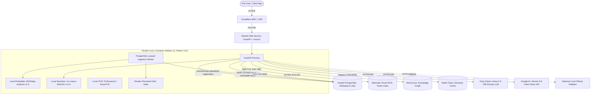

# Enterprise-RAG Production Operations Runbook

**Status:** Operational guidance; deployment has not been validated against live Render services.
**Target Systems:** Render Docker Web Service (FastAPI), Render Static Site (Vite), hosted PostgreSQL, Weaviate Cloud, Neo4j Aura, optional Redis, Groq Cloud API, optional Google Gemini Vision
**Target Audience:** SREs, DevOps Engineers, On-Call Production Engineers

---

## 1. Production Architecture Topology



---

## 2. Environment Variables & Secret Configuration

Production configuration is injected via Render environment variables. **Do not upload or commit `.env` files or actual secret values.**

| Variable Name | Required | Default | Production Value Guidance |
| :--- | :--- | :--- | :--- |
| `APP_ENV` | Yes | `production` | Set to `production` (enables production startup checks and strict CORS). |
| `DEBUG` | Yes | `false` | Must be `false` in production. |
| `DATABASE_URL` | Yes | — | External PostgreSQL connection string. Confirm the provider's SSL requirements. |
| `WEAVIATE_URL` | Yes | — | Weaviate Cloud cluster URL (`https://<cluster-id>.weaviate.cloud`). |
| `WEAVIATE_API_KEY` | Yes | — | Production WCS API Key. |
| `NEO4J_URI` | Yes | `bolt://...` | Neo4j Aura secure endpoint (`neo4j+s://<dbid>.databases.neo4j.io`). |
| `NEO4J_USER` | Yes | `neo4j` | Neo4j username. |
| `NEO4J_PASSWORD` | Yes | — | Strong alphanumeric password. |
| `REDIS_URL` | No | empty | Optional Redis Cloud URI with TLS. Response/embedding caches and Redis rate limiting are disabled if absent. |
| `GROQ_API_KEY` | Yes | — | Production Groq API key for Llama-3.3-70B inference. |
| `LLM_MODEL` | Yes | `llama-3.3-70b-versatile` | Pinned Groq model ID. |
| `OLLAMA_BASE_URL` | No | `http://localhost:11434` | Set only when an external Ollama host is available for fallback; Render localhost is not an Ollama service. |
| `OLLAMA_MODEL` | No | configured model | Model to use if the Ollama fallback is enabled. |
| `VISION_PROVIDER` | Yes | `disabled` | Set to `gemini` if multimodal image processing is enabled; otherwise `disabled`. |
| `GEMINI_API_KEY` | Optional | — | Required only if `VISION_PROVIDER=gemini`. |
| `API_KEY_AUTH_ENABLED` | Yes | `true` | `true` requires configured token credentials. Temporary Render mode is `false`, permitting only PUBLIC reads in the configured default tenant and `default` knowledge base; scope overrides and write/data-management operations are denied. |
| `API_AUTH_TOKEN` | When token authentication is enabled | — | High-entropy secret token for authorized API access. |
| `OPA_ENABLED` | Yes | `true` | Keep `true` for normal operation. With temporary `false`, only PUBLIC retrieval reads in authorized scopes are allowed; image access and protected actions are denied. Health identifies the reduced mode. |
| `OPA_URL` | When OPA is enabled | `http://localhost:8181` (development only) | Hosted OPA decision endpoint. Production startup rejects a localhost URL when OPA is enabled; policy outages deny retrieval. |
| `OPA_AUTH_TOKEN` | If required | empty | Bearer token for the hosted OPA endpoint. |
| `CORS_ORIGINS` | Yes | — | Comma-separated exact frontend origins. |
| `VITE_API_BASE_URL` | Yes (frontend build) | — | Deployed backend URL, baked into the static bundle at build time. |
| `RAW_STORAGE_PATH` | Yes | `/data/raw` | Persistent disk path; the blueprint mounts `/data`. |
| `PROCESSED_STORAGE_PATH`| Yes | `/data/processed` | Persistent disk path. |
| `CHUNKS_STORAGE_PATH` | Yes | `/data/chunks` | Persistent disk path. |
| `INGESTION_JOB_POLL_SECONDS` | No | `1` | Delay between empty/failed PostgreSQL job claims. |
| `INGESTION_JOB_LEASE_SECONDS` | No | `300` | Worker lease duration; heartbeat renews it while a pipeline runs. |
| `INGESTION_JOB_MAX_ATTEMPTS` | No | `3` | Maximum claims per ingestion job, including lease-expired recovery. |

---

### Render Service Settings

The repository root `render.yaml` defines two services:

| Service | Root directory | Build | Start / publish | Health |
|---|---|---|---|---|
| `enterprise-rag-2u7l` | `backend/` | Dockerfile installs the Python project and OS OCR/image libraries | Uvicorn binds `0.0.0.0:$PORT` | `/health/ready` |
| `enterprise-rag-ui` | `frontend/` | `npm ci && npm run build` | Publish `dist/`; `VITE_API_BASE_URL` is a build-time setting | Static site |

The API service uses a persistent disk at `/data`. It depends on separately
provisioned PostgreSQL, Weaviate Cloud, Neo4j Aura, and Groq credentials. Redis
is optional. Ollama defaults to localhost and is **not** available inside the
Render service unless an external Ollama host is configured with
`OLLAMA_BASE_URL`; the Groq-to-Ollama fallback will otherwise fail during an
upstream Groq outage. The local BGE embedding model and reranker also download
model artifacts at runtime and require adequate memory, disk, and outbound
network access.

Set `CORS_ORIGINS` to the actual static-site or custom frontend domain. If a
service name or domain changes, update the frontend's `VITE_API_BASE_URL` and
the backend's CORS allowlist together, then rebuild the frontend.

### Temporary deployment without OPA

The current Render Blueprint temporarily sets both `OPA_ENABLED=false` and
`API_KEY_AUTH_ENABLED=false`. In this combined mode, unauthenticated callers
are pinned to `DEFAULT_TENANT_ID` and the `default` knowledge base, may retrieve
only `PUBLIC` evidence, and cannot override tenant/KB headers, access document
or job endpoints, upload/delete documents, cancel jobs, or retrieve images.
Health reports the limited security mode. Re-enable API token authentication
and hosted OPA before enabling protected content, tenant switching, or
ingestion operations.
---

## 3. Standard Operating Procedures (SOP)

### SOP-01: Deployment & Health Verification
1. Push release branch or trigger manual deploy in Render Dashboard.
2. Monitor build and startup logs. The local embedding model and reranker may download weights at runtime; confirm outbound access, disk capacity, and memory use.
3. Check application startup logs:
   ```text
   startup.config_loaded app=enterprise-rag-backend
   startup.postgres_ready
   startup.weaviate_ready
   startup.neo4j_ready
   startup.redis_ready
   startup.embedding_ready provider=local model=BAAI/bge-small-en-v1.5 device=cpu
   startup.llm_ready provider=groq model=llama-3.3-70b-versatile
   startup.queue_worker_started
   supervisor.database_worker_started
   ```
4. Verify HTTP Health Endpoints:
   - **Liveness:** `GET /health/live` $\rightarrow$ Expect `HTTP 200 {"status": "alive"}`.
   - **Dependency report:** `GET /health` $\rightarrow$ Inspect `status` and each dependency under `services`.
   - **Readiness:** `GET /health/ready` $\rightarrow$ Expect HTTP 200 only when PostgreSQL, Weaviate, Neo4j, and OPA are reachable; otherwise it returns HTTP 503.

### SOP-02: Graceful Service Restart & Queue Drain
When restarting the service to apply configuration updates:
1. Stop or restart the Render service through the dashboard.
2. An interrupted worker does not need an in-memory queue to survive. Its PostgreSQL lease expires and another worker may claim the job, up to `INGESTION_JOB_MAX_ATTEMPTS`.
3. The next worker replays the pipeline from its first step. Stage flags are persisted, but the intermediate parsed/chunk/vector payloads are not restored into `IngestionState`, so replay cannot safely skip prior work.
4. Uploaded PDFs must remain available at the configured storage path. A Render persistent disk supports a single service's local files; multiple independent service instances do not share that disk.
5. Index writes are replay-safe: PostgreSQL chunks use `ON CONFLICT`, Weaviate object UUIDs derive deterministically from chunk IDs, and Neo4j writes use `MERGE`. A partially successful indexing step stays retryable and invalidates cached knowledge-base answers.

### SOP-03: Secret Rotation Procedure
1. Generate a new API key or password at the relevant provider (e.g. Groq, PostgreSQL, Weaviate).
2. Update the environment variable in Render Dashboard.
3. Trigger deploy and wait for `/health/ready` and application logs to confirm the new configuration.
4. Revoke old credentials only after verifying healthy requests with the new configuration.

---

## 4. Failure Modes & Incident Troubleshooting Runbooks

### Runbook 1: Ingestion Pipeline Fails with "File Not Found at Storage Path"
- **Symptom:** Logs show `step.validate.start` followed by a missing file under the configured raw storage path.
- **Root Cause:** Container restart or multiple container instances operating without a shared persistent disk volume.
- **Immediate Mitigation:**
  1. Confirm the Render persistent disk is mounted at `/data`.
  2. Verify environment variables:
     - `RAW_STORAGE_PATH=/data/raw`
     - `PROCESSED_STORAGE_PATH=/data/processed`
     - `CHUNKS_STORAGE_PATH=/data/chunks`
  3. Confirm the worker and the upload request use the same mounted disk. Separate Render instances do not share these files.
  4. If the file is absent, re-upload it; the pipeline cannot reconstruct a PDF from PostgreSQL job metadata.

### Runbook 2: Groq LLM Rate Limit (HTTP 429) or Outage (HTTP 503)
- **Symptom:** Query requests fail or log `llm.groq_rate_limit_exceeded`.
- **Behavior:** Provider-level retry/fallback behavior is bounded, but a failed generation can still return an HTTP error.
- **Escalation Steps:**
  1. If Groq rate limits persist, request rate exceeds tier limit: Check `RateLimitMiddleware` logs to identify rogue tenant.
  2. Ollama defaults to localhost and is not available on Render. Configure an external Ollama host or another supported hosted provider before relying on it as a fallback.

### Runbook 3: Weaviate Cloud Connection Timeout
- **Symptom:** Queries return HTTP 500; logs show `weaviate.exceptions.WeaviateConnectionError`.
- **Mitigation:**
  1. Check WCS status at `https://status.weaviate.io`.
  2. Verify WCS cluster has not entered sleep mode (sandbox tiers auto-sleep after inactivity).
  3. Verify outgoing network rules on Render: Port 443 outbound must be unrestricted.
  4. Both dense and BM25 search use Weaviate. With Weaviate unavailable, those channels are unavailable; graph search may still produce results if Neo4j and PostgreSQL are healthy, but this is not a full retrieval fallback.

### Runbook 4: Cross-Tenant Data Access Attempt (Security Alert)
- **Symptom:** Log entry: `security.privilege_escalation_prevented requested_level=RESTRICTED granted_level=INTERNAL`.
- **Action:**
  1. Extract `client_ip`, `tenant_id`, and `request_id` from structured log.
  2. Verify if the client IP belongs to an authenticated partner or external scanner.
  3. If hostile, add IP block to Cloudflare WAF.
  4. Verify that data remained protected: check that no `RESTRICTED` documents were returned.

---

## 5. Alerting Thresholds & SLIs/SLOs

The values below are proposed operational targets, not measured SLIs or verified
service-level objectives. Establish a production telemetry baseline before
adopting them as guarantees.

| Service Level Indicator (SLI) | Target Objective (SLO) | Warning Threshold (Paging) | Critical Threshold (Incident) |
| :--- | :--- | :--- | :--- |
| **API Availability (Query)** | $99.9\%$ uptime | $< 99.5\%$ over 5 min | $< 99.0\%$ over 2 min |
| **P95 Query Latency** | $< 1.8\text{ s}$ | $> 2.5\text{ s}$ over 5 min | $> 4.0\text{ s}$ over 2 min |
| **Ingestion Success Rate** | $99.0\%$ | $< 95.0\%$ over 15 min | $< 90.0\%$ over 10 min |
| **Hallucination Abstention Accuracy** | $100\%$ | $< 98.0\%$ | Any fabricated specification reported |
| **Container Memory Usage** | $< 75\%$ of 2GB | $> 80\%$ (Worker warning) | $> 90\%$ (OOM risk) |
