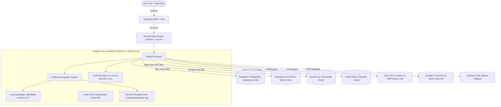

# Enterprise-RAG Production Operations Runbook

**Date:** 2026-10-22  
**Target Systems:** Render Web Service (FastAPI), Supabase PostgreSQL, Weaviate Cloud, Neo4j Aura, Redis Cloud, Groq Cloud API, Google Gemini Cloud Vision  
**Target Audience:** SREs, DevOps Engineers, On-Call Production Engineers

---

## 1. Production Architecture Topology



---

## 2. Environment Variables & Secret Configuration

All production configuration must be injected via Render Dashboard Environment Variables or a hardened `.env` file. **Never commit actual values to Git.**

| Variable Name | Required | Default | Production Value Guidance |
| :--- | :--- | :--- | :--- |
| `APP_ENV` | Yes | `production` | Set to `production` (disables debug swagger details, enables strict CORS). |
| `DEBUG` | Yes | `false` | Must be `false` in production. |
| `DATABASE_URL` | Yes | — | Supabase PostgreSQL connection string with `sslmode=require` and pool size 20. |
| `WEAVIATE_URL` | Yes | — | Weaviate Cloud cluster URL (`https://<cluster-id>.weaviate.cloud`). |
| `WEAVIATE_API_KEY` | Yes | — | Production WCS API Key. |
| `NEO4J_URI` | Yes | `bolt://...` | Neo4j Aura secure endpoint (`neo4j+s://<dbid>.databases.neo4j.io`). |
| `NEO4J_USER` | Yes | `neo4j` | Neo4j username. |
| `NEO4J_PASSWORD` | Yes | — | Strong alphanumeric password. |
| `REDIS_URL` | Yes | — | Redis Cloud URI with TLS (`rediss://default:<password>@<host>:<port>`). |
| `GROQ_API_KEY` | Yes | — | Production Groq API key for Llama-3.3-70B inference. |
| `LLM_MODEL` | Yes | `llama-3.3-70b-versatile` | Pinned Groq model ID. |
| `VISION_PROVIDER` | Yes | `disabled` | Set to `gemini` if multimodal image processing is enabled; otherwise `disabled`. |
| `GEMINI_API_KEY` | Optional | — | Required only if `VISION_PROVIDER=gemini`. |
| `API_KEY_AUTH_ENABLED` | Yes | `true` | Must be `true` in production to enforce Bearer token validation. |
| `API_AUTH_TOKEN` | Yes | — | High-entropy secret token (min 32 characters) for authorized API access. |
| `RAW_STORAGE_PATH` | Yes | `/var/data/enterprise-rag/raw` | Mount path on Render Persistent Disk. |
| `PROCESSED_STORAGE_PATH`| Yes | `/var/data/enterprise-rag/processed` | Mount path on Render Persistent Disk. |
| `CHUNKS_STORAGE_PATH` | Yes | `/var/data/enterprise-rag/chunks` | Mount path on Render Persistent Disk. |

---

## 3. Standard Operating Procedures (SOP)

### SOP-01: Deployment & Health Verification
1. Push release branch or trigger manual deploy in Render Dashboard.
2. Monitor build logs: verify Python dependencies install without warnings and local model weights (`bge-small-en-v1.5`) cache properly.
3. Check application startup logs:
   ```text
   startup.config_loaded app=enterprise-rag-backend
   startup.postgres_ready
   startup.weaviate_ready
   startup.neo4j_ready
   startup.redis_ready
   startup.embedding_ready provider=local model=BAAI/bge-small-en-v1.5 device=cpu
   startup.llm_ready provider=groq model=llama-3.3-70b-versatile
   startup.queue_worker_started
   ```
4. Verify HTTP Health Endpoints:
   - **Liveness:** `GET /health` $\rightarrow$ Expect `HTTP 200 {"status": "ok"}`
   - **Readiness:** `GET /health/ready` $\rightarrow$ Expect `HTTP 200 {"postgres": "connected", "weaviate": "connected", "neo4j": "connected"}`

### SOP-02: Graceful Service Restart & Queue Drain
When restarting the service to apply configuration updates:
1. Trigger zero-downtime rolling restart via Render Dashboard.
2. The `IngestionSupervisor` automatically catches SIGTERM; currently running pipeline steps complete within their bounded timeout.
3. Upon new container startup, `supervisor.process_queue()` queries PostgreSQL for any documents in `PENDING` or `PROCESSING` state and automatically requeues them.

### SOP-03: Secret Rotation Procedure
1. Generate new API key in third-party provider (e.g. Groq, Supabase, Weaviate).
2. Update the environment variable in Render Dashboard.
3. Trigger deploy. The new container spins up and confirms connectivity before old containers terminate.
4. Revoke old credentials in the third-party provider after verifying healthy request logs.

---

## 4. Failure Modes & Incident Troubleshooting Runbooks

### Runbook 1: Ingestion Pipeline Fails with "File Not Found at Storage Path"
- **Symptom:** Logs show `event: step.validate.start, File not found at storage path: /opt/render/project/src/backend/data/raw/...`
- **Root Cause:** Container restart or multiple container instances operating without a shared persistent disk volume.
- **Immediate Mitigation:**
  1. Confirm Render Persistent Disk is attached and mounted at `/var/data/enterprise-rag`.
  2. Verify environment variables:
     - `RAW_STORAGE_PATH=/var/data/enterprise-rag/raw`
     - `PROCESSED_STORAGE_PATH=/var/data/enterprise-rag/processed`
     - `CHUNKS_STORAGE_PATH=/var/data/enterprise-rag/chunks`
  3. Verify write permissions on mount: `chmod -R 775 /var/data/enterprise-rag`.
  4. The automated fallback in `s01_validate.py` automatically recovers uncorrupted files located in the authoritative raw directory.

### Runbook 2: Groq LLM Rate Limit (HTTP 429) or Outage (HTTP 503)
- **Symptom:** Query requests fail or log `llm.groq_rate_limit_exceeded`.
- **Behavior:** `GroqLLMProvider` automatically retries up to 3 times with exponential backoff.
- **Escalation Steps:**
  1. If Groq rate limits persist, request rate exceeds tier limit: Check `RateLimitMiddleware` logs to identify rogue tenant.
  2. If Groq has an upstream outage, switch `LLM_PROVIDER=ollama` or route to backup Groq key in Render environment settings.

### Runbook 3: Weaviate Cloud Connection Timeout
- **Symptom:** Queries return HTTP 500; logs show `weaviate.exceptions.WeaviateConnectionError`.
- **Mitigation:**
  1. Check WCS status at `https://status.weaviate.io`.
  2. Verify WCS cluster has not entered sleep mode (sandbox tiers auto-sleep after inactivity).
  3. Verify outgoing network rules on Render: Port 443 outbound must be unrestricted.
  4. Hybrid retrieval automatically handles degraded vector search by continuing with PostgreSQL metadata and BM25 search.

### Runbook 4: Cross-Tenant Data Access Attempt (Security Alert)
- **Symptom:** Log entry: `security.privilege_escalation_prevented requested_level=RESTRICTED granted_level=INTERNAL`.
- **Action:**
  1. Extract `client_ip`, `tenant_id`, and `request_id` from structured log.
  2. Verify if the client IP belongs to an authenticated partner or external scanner.
  3. If hostile, add IP block to Cloudflare WAF.
  4. Verify that data remained protected: check that no `RESTRICTED` documents were returned.

---

## 5. Alerting Thresholds & SLIs/SLOs

| Service Level Indicator (SLI) | Target Objective (SLO) | Warning Threshold (Paging) | Critical Threshold (Incident) |
| :--- | :--- | :--- | :--- |
| **API Availability (Query)** | $99.9\%$ uptime | $< 99.5\%$ over 5 min | $< 99.0\%$ over 2 min |
| **P95 Query Latency** | $< 1.8\text{ s}$ | $> 2.5\text{ s}$ over 5 min | $> 4.0\text{ s}$ over 2 min |
| **Ingestion Success Rate** | $99.0\%$ | $< 95.0\%$ over 15 min | $< 90.0\%$ over 10 min |
| **Hallucination Abstention Accuracy** | $100\%$ | $< 98.0\%$ | Any fabricated specification reported |
| **Container Memory Usage** | $< 75\%$ of 2GB | $> 80\%$ (Worker warning) | $> 90\%$ (OOM risk) |
