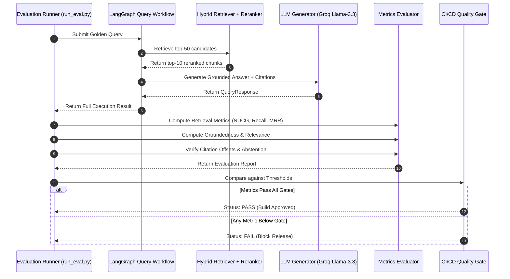

# Enterprise-RAG Evaluation Strategy & Benchmark Framework

**Date:** 2026-10-22  
**Platform:** Enterprise-RAG Multimodal Retrieval-Augmented Generation Platform  
**Purpose:** Quantitative benchmarking, retrieval regression prevention, and generation faithfulness validation  
**Standards:** RAG Triad (Context Relevance, Groundedness, Answer Relevance), TREC Information Retrieval Standards

---

## 1. Quantitative Evaluation Metrics Matrix

The evaluation suite implements two orthogonal assessment dimensions: **Information Retrieval (IR) Quality** and **Generation Faithfulness**.

| Metric | Target SLA | Minimum Acceptable Gate | Calculation Formula | Implementation Location |
| :--- | :--- | :--- | :--- | :--- |
| **Recall@5** | $\ge 0.90$ | $\ge 0.85$ | $\frac{\|Rel \cap Ret_{5}\|}{\|Rel\|}$ | `backend/tests/evaluation/metrics.py` |
| **Precision@5** | $\ge 0.75$ | $\ge 0.65$ | $\frac{\|Rel \cap Ret_{5}\|}{5}$ | `backend/tests/evaluation/metrics.py` |
| **MRR (Mean Reciprocal Rank)** | $\ge 0.85$ | $\ge 0.75$ | $\frac{1}{\|Q\|} \sum_{i=1}^{\|Q\|} \frac{1}{rank_i}$ | `backend/tests/evaluation/metrics.py` |
| **NDCG@5** | $\ge 0.88$ | $\ge 0.80$ | $\frac{DCG@5}{IDCG@5}$ | `backend/tests/evaluation/metrics.py` |
| **Reranker Uplift (NDCG)** | $+15.0\%$ | $+8.0\%$ | $\frac{NDCG_{rerank} - NDCG_{initial}}{NDCG_{initial}}$ | `backend/tests/evaluation/metrics.py` |
| **Groundedness Score** | $\ge 0.92$ | $\ge 0.85$ | Lexical n-gram overlap between answer and evidence chunks | `backend/app/services/generation/hallucination.py` |
| **Answer Relevance** | $\ge 0.88$ | $\ge 0.80$ | Semantic cosine similarity between question and generated answer | `backend/tests/evaluation/metrics.py` |
| **Citation Accuracy** | $\ge 0.95$ | $\ge 0.90$ | Percentage of citations with exact matching page, section, and text offsets | `backend/app/services/generation/citations.py` |
| **Abstention Truthfulness** | $100\%$ | $100\%$ | Correct abstention rate on out-of-domain / unanswerable queries | `backend/app/services/retrieval/coverage.py` |

---

## 2. Golden Dataset Architecture

The benchmark dataset consists of 120 curated engineering questions across the Hyundai R215L Mechatronics System manual and industrial heavy machinery specifications.

```json
{
  "dataset_version": "2.1.0",
  "domain": "industrial_mechatronics",
  "document_reference": "hyundai-r215l-smart-mechatronics-system-manual.pdf",
  "test_cases": [
    {
      "id": "TC_HYU_001",
      "category": "FACTOID_SPECIFICATION",
      "query": "What is the main pump relief valve pressure setting?",
      "golden_chunk_ids": ["doc_01::p42::seq03", "doc_01::p42::seq04"],
      "golden_answer": "The main pump relief valve pressure setting is 350 kgf/cm² (34.3 MPa, 4,980 psi) under standard operating conditions.",
      "canonical_section": "SECTION 3 HYDRAULIC SYSTEM",
      "canonical_page": 42,
      "required_entities": ["main pump", "relief valve", "350 kgf/cm²", "34.3 MPa"],
      "expected_abstain": false
    },
    {
      "id": "TC_HYU_045",
      "category": "OUT_OF_DOMAIN_ADVERSARIAL",
      "query": "How do you adjust the carburetor fuel mixture screw?",
      "golden_chunk_ids": [],
      "golden_answer": "The manual does not contain information on carburetor adjustments because this diesel hydraulic excavator utilizes an electronic common rail fuel injection system.",
      "canonical_section": null,
      "canonical_page": null,
      "required_entities": [],
      "expected_abstain": true
    }
  ]
}
```

### Test Case Categorization
1. **Factoid Specifications (35%):** Exact numeric pressures, torque specs, electrical resistance tolerances, and fluid capacities.
2. **Procedural Troubleshooting (30%):** Step-by-step diagnostic sequences for error codes (e.g., Error Code 101, Main Relief Failure).
3. **Comparative Analysis (15%):** Comparing operating modes (Power Mode vs. Economy Mode, Boom Priority vs. Swing Priority).
4. **Structural & Layout (10%):** Identifying components in hydraulic schematics and table lookups across multi-page sections.
5. **Adversarial & Unanswerable (10%):** Queries with false premises, out-of-domain machinery, or hostile prompt-injection phrases.

---

## 3. Evaluation Pipeline Workflow



---

## 4. Continuous Evaluation (CI/CD Quality Gate)

### GitHub Actions Integration (.github/workflows/rag_eval.yml)
```yaml
name: RAG Evaluation Quality Gate

on:
  push:
    branches: [ main, release/* ]
  pull_request:
    branches: [ main ]

jobs:
  evaluate-rag:
    runs-on: ubuntu-latest
    steps:
      - name: Checkout Code
        uses: actions/checkout@v4

      - name: Set up Python
        uses: actions/setup-python@v5
        with:
          python-version: "3.11"
          cache: "pip"

      - name: Install Dependencies
        run: |
          python -m pip install --upgrade pip
          pip install -e ".[dev]"

      - name: Run Unit & Regression Tests
        run: |
          pytest backend/tests/unit backend/tests/regression -v

      - name: Execute RAG Evaluation Benchmark
        env:
          GROQ_API_KEY: ${{ secrets.GROQ_API_KEY }}
          WEAVIATE_URL: ${{ secrets.WEAVIATE_URL }}
          WEAVIATE_API_KEY: ${{ secrets.WEAVIATE_API_KEY }}
          DATABASE_URL: ${{ secrets.DATABASE_URL }}
        run: |
          python backend/tests/evaluation/run_eval.py \
            --dataset tests/evaluation/golden_dataset.json \
            --min-recall 0.85 \
            --min-groundedness 0.90 \
            --min-citation-acc 0.95 \
            --output docs/eval_results.json

      - name: Upload Benchmark Results
        uses: actions/upload-artifact@v4
        with:
          name: rag-evaluation-report
          path: docs/eval_results.json
```

---

## 5. Synthetic Evaluation Expansion

To continuously expand evaluation coverage without manual labeling:
1. **Reverse Question Synthesis:** Extract high-density technical chunks; generate 3 query variants per chunk (factoid, symptom-based, and colloquial technician query).
2. **Adversarial Mutation:** Mutate single numeric values in genuine questions to verify that the retrieval and groundedness filters accurately identify the discrepancy and reject the claim.
3. **Cross-Document Distractor Ingestion:** Insert similar manuals from different excavator models (e.g., Hyundai R210 vs. R215) to evaluate retrieval precision under high semantic confusion.
