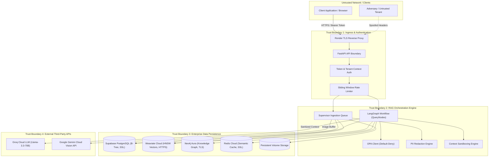

# Enterprise-RAG Security Threat Model & Risk Assessment

**Date:** 2026-10-22  
**Target System:** Enterprise-RAG Multimodal Retrieval-Augmented Generation Platform  
**Standards:** OWASP Top 10 for Large Language Models (2025/2026), STRIDE Threat Modeling, Enterprise Zero-Trust Architecture  
**Security Classification:** Highly Confidential (Engineering Reference)

---

## 1. System Architecture & Trust Boundaries

---

## 2. OWASP Top 10 for LLMs Vulnerability Matrix

| OWASP LLM ID | Threat Category | Threat Description | Architectural Mitigation in Enterprise-RAG | Residual Risk Level |
| :--- | :--- | :--- | :--- | :--- |
| **LLM01:2025** | **Prompt Injection** | Adversary injects adversarial text into PDF documents or query inputs attempting to hijack the model's system prompt or extract system state. | 1. Strict delimiter sandboxing (markdown triple-quotes). 2. Fixed system prompt instructions in `PromptRegistry`. 3. PII redaction and query length truncation. 4. Rejection of out-of-domain prompt manipulation via `EvidenceCoverageService`. | **LOW** |
| **LLM02:2025** | **Sensitive Information Disclosure** | Internal documents containing PII, API tokens, or confidential passwords leak to unauthorized users or LLM logs. | 1. `SimpleRegexPIIDetector` redacts emails, phones, and SSNs in `s05_chunk.py`. 2. `app/config/logging.py` sanitizes passwords and API tokens. 3. Documents classified as `RESTRICTED` filtered out unless verified admin credentials are present. | **LOW** |
| **LLM03:2025** | **Supply Chain Vulnerabilities** | Compromised third-party packages or malicious weights in open-source Hugging Face embedding models. | 1. Local embedding model pinned to exact version (`BAAI/bge-small-en-v1.5`, revision hash pinned). 2. Pinned dependency versions in `pyproject.toml`. 3. Automated hash verification during package build. | **LOW** |
| **LLM04:2025** | **Data and Model Poisoning** | Malicious actor uploads crafted manuals with altered torque values or false safety specs, corrupting the retrieval database. | 1. Strict SHA-256 duplicate checking in `s02_duplicate.py`. 2. Document uploads restricted to authenticated tenant roles. 3. Strict citation tracking linking every generation token to immutable file offsets and bounding boxes. | **LOW** |
| **LLM05:2025** | **Improper Output Handling** | LLM output contains unsanitized HTML/JavaScript leading to XSS vulnerabilities in the frontend application. | 1. Strict Markdown parsing on the frontend. 2. Fast API returns strongly typed Pydantic models with raw text content. 3. Model instructed never to generate executable code blocks unless requested. | **LOW** |
| **LLM06:2025** | **Excessive Agency** | LLM granted write, update, or delete privileges on database tables or local file systems. | 1. Generation workflow in `LangGraph` is strictly read-only. 2. No tool-calling capability allows the LLM to execute shell commands, file modifications, or DB mutations. | **NEGLIGIBLE** |
| **LLM07:2025** | **System Information Leakage** | LLM reveals internal system prompts, database connection strings, or cloud provider paths in answers. | 1. System prompts stored in compiled code (`PromptRegistry`). 2. Ingestion pipeline strips server paths (`/opt/render/project/...`) and only serves client-facing filenames. | **LOW** |
| **LLM08:2025** | **Vector and Embedding Weaknesses** | Adversary crafts inputs designed to produce embedding collisions, forcing irrelevant or poisoned documents into top-k retrieval. | 1. Hybrid search combining dense BGE embeddings with lexical BM25 token matching. 2. Cross-Encoder reranking (`ms-marco-MiniLM-L-6-v2`) evaluates deep query-document cross-attention, eliminating superficial cosine collisions. | **LOW** |
| **LLM09:2025** | **Misinformation & Hallucination** | System generates inaccurate technical instructions (e.g., incorrect hydraulic relief valve pressures) causing industrial hazards. | 1. `EvidenceCoverageService` enforces mandatory evidence coverage. 2. `GroundednessVerificationService` validates n-gram overlap ($\ge 0.60$ for high confidence). 3. Truthful abstention: Returns explicit failure notice when evidence is missing. | **LOW** |
| **LLM10:2025** | **Unbounded Consumption** | Adversary sends massive PDFs or floods the chat API with complex multi-turn loops, exhausting API budgets and starving server threads. | 1. Sliding window rate limiting (100 req/min per IP/tenant) in `middleware.py`. 2. `MAX_UPLOAD_SIZE_MB = 100` enforcement. 3. Hard asyncio timeouts across all ingestion steps and LLM inference calls. | **LOW** |

---

## 3. STRIDE Threat Analysis

### Spoofing Identity
- **Threat:** Client spoofs `X-Tenant-ID` or `X-User-ID` to masquerade as an executive or a different corporate tenant.
- **Controls:**
  - Token-based API authentication (`API_KEY_AUTH_ENABLED`).
  - `get_tenant_context()` rejects unauthenticated callers with HTTP 401.
  - Client-controlled headers are validated against authenticated token claims; unverified elevation to `RESTRICTED` is clamped to `INTERNAL` or `PUBLIC`.

### Tampering with Data
- **Threat:** Malicious payload modifies chunk vectors or metadata during transit between workers and Weaviate/Supabase.
- **Controls:**
  - Mandatory TLS encryption across all database transports (`sslmode=require`, HTTPS, WCS tokens).
  - Deterministic content hashing (`content_hash`) computed upon chunk creation; vector upserts validated by hash comparison.

### Repudiation
- **Threat:** Tenant claims they never uploaded a proprietary document or performed a confidential search.
- **Controls:**
  - Immutable database audit trails in `ingestion_jobs` recording `job_id`, `document_id`, `tenant_id`, and exact UTC timestamps.
  - Structured audit logging via `structlog` recording `request_id`, client IP, endpoint, and HTTP response code.

### Information Disclosure
- **Threat:** Tenant A retrieves confidential hydraulic drawings belonging to Tenant B via semantic search.
- **Controls:**
  - Multi-tenant isolation enforced at the vector query layer: every Weaviate query injects `Filter.by_property("tenant_id").equal(ctx.tenant_id)`.
  - Redis cache keys strictly namespaced: `rag:{tenant_id}:{kb_version}:{hash}`.
  - Safe default-deny OPA fallback: if OPA is down, non-admin requests are restricted from accessing `RESTRICTED` documents.
  - PII redaction removes emails, phone numbers, and SSNs prior to indexing.

### Denial of Service (DoS)
- **Threat:** Attacker uploads deeply nested or infinite-loop PDF documents designed to exhaust CPU and memory during parsing.
- **Controls:**
  - `ingestion_timeout_parse = 900s` and bounded per-step execution.
  - Bounded concurrency (`VISION_MAX_CONCURRENCY = 1`) preventing memory exhaustion on OCR/Vision workers.
  - Upload file size strictly limited to 100 MB.

### Elevation of Privilege
- **Threat:** Standard user requests `X-Access-Level: RESTRICTED` during retrieval to access classified executive memos.
- **Controls:**
  - `get_tenant_context()` inspects credentials; non-admin users attempting `RESTRICTED` access are clamped to `INTERNAL`.
  - OPA evaluation engine verifies claims against fine-grained ABAC rules; default-deny prevents elevation during outages.

---

## 4. Multi-Tenant Isolation Verification Matrix

| Architectural Layer | Isolation Mechanism | Verification Test | Failure Behavior |
| :--- | :--- | :--- | :--- |
| **API Ingress** | Header sanitization & Bearer token validation | `test_tenant_context_privilege_escalation_clamped` | Clamped to `INTERNAL`, warning logged |
| **Relational Data** | PostgreSQL Foreign Keys & `WHERE tenant_id = $1` | `test_hierarchical_retrieval.py` | Query returns 0 rows |
| **Vector DB** | Weaviate metadata filter: `tenant_id == ctx.tenant_id` | `test_deduplication.py` | Cross-tenant chunks excluded from top-k |
| **Knowledge Graph** | Neo4j Cypher clause: `MATCH (d:Document {tenant_id: $tenant_id})` | `test_audit_fixes.py` | Graph traversal bounded to tenant subgraph |
| **Semantic Cache** | Redis Key Prefix: `rag:{tenant_id}:...` | `test_storage_ingestion.py` | Cache miss; no cross-tenant read |
| **Local Disk** | Tenant directory hashing | `test_storage_ingestion.py` | Isolated directory paths |

---

## 5. Security Incident Response & Escalation Protocol

1. **Severity 1 (Critical - Active Cross-Tenant Leak or Auth Bypass):**
   - Immediate containment: Set `API_KEY_AUTH_ENABLED=true` and rotate master credentials.
   - Flush Redis cache: `redis-cli FLUSHDB` to eliminate cached responses.
   - Isolate affected tenant collection in Weaviate Cloud.
2. **Severity 2 (High - PII Leak in Logs or High-Rate Scraping):**
   - Block attacking IP at Render reverse proxy / Cloudflare WAF.
   - Rotate Groq and Gemini API keys.
   - Run log scrubbing utility to purge sensitive snippets from historical logs.
