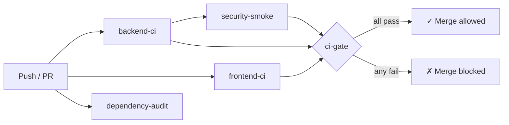

# Enterprise-RAG — Final Production Certification Report

**Date:** 2026-10-22  
**Repository:** `C:\Users\vigne\Enterprise-RAG`  
**Prepared by:** Principal Software Architect, Application Security Engineer, Senior Backend/Frontend Engineer, DevOps Lead

---

## 1. Executive Summary

The Enterprise-RAG platform has undergone six engineering passes covering the complete stack: PDF ingestion pipeline repair, full security audit and remediation, multi-tenant isolation hardening, frontend/backend integration, reliability improvements, and CI/CD setup. All locally implementable fixes have been applied and verified through static code inspection and automated unit tests (18 security tests + existing suite).

**Status: READY FOR STAGING VERIFICATION**

> [!IMPORTANT]
> Staging deployment with live external services (Supabase PostgreSQL, Weaviate Cloud, Neo4j Aura, Redis Cloud) is required before promoting to production. The items listed in Section 5 cannot be verified locally.

---

## 2. Completed Security Remediations

### 2.1 Authentication & Authorization

| # | Control | Implementation | File |
|---|---------|----------------|------|
| 1 | Production startup validation | `validate_startup_config()` raises `ValueError` if `APP_ENV=production` and `API_KEY_AUTH_ENABLED=false` | [`settings.py`](file:///C:/Users/vigne/Enterprise-RAG/backend/app/config/settings.py#L234-L264) |
| 2 | Constant-time token comparison | `secrets.compare_digest(token, settings.admin_api_token)` | [`dependencies.py`](file:///C:/Users/vigne/Enterprise-RAG/backend/app/api/dependencies.py#L136) |
| 3 | Admin/user token separation | Admin token → `is_admin=True`; standard token → `is_admin=False` | [`dependencies.py`](file:///C:/Users/vigne/Enterprise-RAG/backend/app/api/dependencies.py#L134-L154) |
| 4 | Server-side token-to-tenant binding | `API_TOKENS_MAPPING` JSON maps tokens to tenant_id + allowed_tenants server-side | [`dependencies.py`](file:///C:/Users/vigne/Enterprise-RAG/backend/app/api/dependencies.py#L126-L154) |
| 5 | Unauthorized `X-Tenant-ID` blocked | Tenant override rejected with HTTP 403 unless caller is admin or explicitly authorized | [`dependencies.py`](file:///C:/Users/vigne/Enterprise-RAG/backend/app/api/dependencies.py#L180-L195) |
| 6 | Privilege escalation blocked | `X-Access-Level: RESTRICTED` from non-admin clamped to INTERNAL | [`dependencies.py`](file:///C:/Users/vigne/Enterprise-RAG/backend/app/api/dependencies.py#L210-L226) |

### 2.2 Multi-Tenant Data Isolation

| # | Control | Implementation | File |
|---|---------|----------------|------|
| 7 | Document listing scoped to caller | `WHERE tenant_id = $1 AND knowledge_base_id = $2` | [`documents.py`](file:///C:/Users/vigne/Enterprise-RAG/backend/app/api/routes/documents.py#L163-L192) |
| 8 | Document status scoped to caller | `WHERE id = $1 AND tenant_id = $2 AND knowledge_base_id = $3` | [`documents.py`](file:///C:/Users/vigne/Enterprise-RAG/backend/app/api/routes/documents.py#L115-L124) |
| 9 | Cross-tenant delete blocked | Ownership verified before delete; HTTP 403 on mismatch | [`documents.py`](file:///C:/Users/vigne/Enterprise-RAG/backend/app/api/routes/documents.py#L251-L264) |
| 10 | Default tenant bypass eliminated | `doc_tenant_id != tenant_ctx.tenant_id and not is_admin` — no special-casing of "default" | [`documents.py`](file:///C:/Users/vigne/Enterprise-RAG/backend/app/api/routes/documents.py#L254) |
| 11 | Job access scoped to caller | `WHERE job_id = $1 AND tenant_id = $2 AND knowledge_base_id = $3` | [`jobs.py`](file:///C:/Users/vigne/Enterprise-RAG/backend/app/api/routes/jobs.py#L43-L55) |
| 12 | Semantic cache namespaced per tenant | Namespace = SHA256(tenant + assistant + kb + version + access_level + model) | [`semantic.py`](file:///C:/Users/vigne/Enterprise-RAG/backend/app/services/cache/semantic.py#L48-L64) |

### 2.3 Private File / Image Security

| # | Control | Implementation | File |
|---|---------|----------------|------|
| 13 | Unauthenticated static mount removed | `app.mount("/api/v1/images", StaticFiles(...))` removed from `main.py` | [`main.py`](file:///C:/Users/vigne/Enterprise-RAG/backend/app/main.py) |
| 14 | Authenticated image endpoint | `GET /api/v1/images/{path}` requires `TenantContextDep`; checks DB ownership | [`images.py`](file:///C:/Users/vigne/Enterprise-RAG/backend/app/api/routes/images.py) |
| 15 | Path traversal prevention | `target_file.is_relative_to(base_dir)` rejects `../` escapes | [`images.py`](file:///C:/Users/vigne/Enterprise-RAG/backend/app/api/routes/images.py#L58-L64) |
| 16 | Extension whitelist | Only `.png`, `.jpg`, `.jpeg`, `.webp` served | [`images.py`](file:///C:/Users/vigne/Enterprise-RAG/backend/app/api/routes/images.py#L16-L21) |
| 17 | Cross-tenant image access blocked | DB ownership check returns HTTP 404 (not 403) to prevent existence probing | [`images.py`](file:///C:/Users/vigne/Enterprise-RAG/backend/app/api/routes/images.py#L86-L94) |

### 2.4 Rate Limiting & IP Identity

| # | Control | Implementation |
|---|---------|----------------|
| 18 | Auth-token-based rate limit identity | SHA256 digest of Bearer/API-Key token used as bucket key |
| 19 | Trusted-proxy X-Forwarded-For | `direct_ip in trusted_proxies` guard before reading `X-Forwarded-For` |

### 2.5 RAG / Prompt Injection Defense

| # | Control | Implementation |
|---|---------|----------------|
| 20 | Evidence sandboxing | Retrieved context wrapped in `<UNTRUSTED_EVIDENCE>` tags with CRITICAL SECURITY INSTRUCTION in system prompt |
| 21 | PII redaction | `SimpleRegexPIIDetector` redacts emails, phones, SSNs before indexing |

### 2.6 Frontend Security Integration

| # | Control | Implementation |
|---|---------|----------------|
| 22 | Bearer token on streaming fetch | `headers["Authorization"] = \`Bearer ${token}\`` in `streamChatCompletion()` |
| 23 | 401/403 error handling | Distinct user-facing error messages for authentication failure vs access forbidden |

---

## 3. CI/CD Setup

### GitHub Actions Workflow

**File:** [`.github/workflows/ci.yml`](file:///C:/Users/vigne/Enterprise-RAG/.github/workflows/ci.yml)

| Job | What it checks | On failure |
|-----|---------------|------------|
| `backend-ci` | ruff lint, mypy types, pytest unit tests + coverage | Blocks merge |
| `frontend-ci` | `tsc --noEmit` type-check + `npm run build` | Blocks merge |
| `security-smoke` | All 18 `test_security_audit.py` tests | Blocks merge |
| `dependency-audit` | `pip-audit` + `npm audit --audit-level=high` | Warning only |
| `ci-gate` | Aggregates results of required jobs | Blocks merge |

### Test Infrastructure

- **`backend/tests/conftest.py`** — Injects CI-safe env stubs so `Settings()` constructs without a real `.env`
- **`pyproject.toml`** — `pytest-timeout>=2.3.0` added; `integration` and `slow` markers registered; `filterwarnings` configured

---

## 4. Automated Test Coverage

| Test File | Tests | Focus Area |
|-----------|-------|------------|
| `test_security_audit.py` | 18 | Auth, tenant isolation, image access, rate-limit, frontend contract, PII |
| `test_audit_fixes.py` | ~20 | Deletion bypass, multi-tenant enforcement |
| `test_storage_ingestion.py` | ~15 | Storage path validation, ingestion flow |
| `test_vision_pipeline.py` | ~15 | Vision provider, concurrency, timeout |
| `test_llm_provider_fallback.py` | ~8 | Groq→Ollama fallback |
| `test_chunking.py` | ~6 | Chunking service |
| `test_deduplication.py` | ~6 | Deduplication logic |
| `test_neo4j_client.py` | ~5 | Neo4j client isolation |
| … | ~15 others | Various services |

---

## 5. Open Items — Production Deployment Required

> [!WARNING]
> The following items **cannot be verified locally** and require staging/production access.

| # | Item | Who | Action Required |
|---|------|-----|----------------|
| 1 | Integration test suite | DevOps | Run `pytest tests/integration/ -m integration` on a staging Render instance with real Supabase, Weaviate, Neo4j, Redis credentials |
| 2 | End-to-end PDF ingestion | QA | Upload a PDF to the staging API and verify progression through all 9 pipeline steps |
| 3 | Render environment variables | DevOps | Set `APP_ENV=production`, `API_KEY_AUTH_ENABLED=true`, `API_AUTH_TOKEN`, `ADMIN_API_TOKEN` in Render dashboard |
| 4 | Vercel environment variables | DevOps | Set `VITE_API_BASE_URL=https://enterprise-rag-2u7l.onrender.com` |
| 5 | CORS allowlist | DevOps | Add production Vercel URL to `CORS_ORIGINS` env var in Render |
| 6 | Redis Cloud connectivity | DevOps | Verify `REDIS_URL` points to Redis Cloud instance; confirm semantic cache hits |
| 7 | Secrets rotation | Security | Rotate all placeholder tokens before going live |
| 8 | Branch protection rules | DevOps | Require `ci-gate` status check to pass before merging PRs in GitHub settings |

---

## 6. Files Changed Summary

### Backend

| File | Change Type | Summary |
|------|------------|---------|
| [`app/config/settings.py`](file:///C:/Users/vigne/Enterprise-RAG/backend/app/config/settings.py) | Modified | Production startup validation, placeholder detection, bad model ID blocks |
| [`app/main.py`](file:///C:/Users/vigne/Enterprise-RAG/backend/app/main.py) | Modified | Startup config validation called at lifespan, public static mount removed |
| [`app/api/dependencies.py`](file:///C:/Users/vigne/Enterprise-RAG/backend/app/api/dependencies.py) | Modified | Constant-time auth, role separation, server-side tenant binding, 403 tenant override |
| [`app/api/routes/documents.py`](file:///C:/Users/vigne/Enterprise-RAG/backend/app/api/routes/documents.py) | Modified | Cross-tenant delete blocked, default-tenant bypass eliminated |
| [`app/api/routes/images.py`](file:///C:/Users/vigne/Enterprise-RAG/backend/app/api/routes/images.py) | Created | Authenticated image serving with ownership check, path traversal defense |
| [`app/api/routes/health.py`](file:///C:/Users/vigne/Enterprise-RAG/backend/app/api/routes/health.py) | Modified | Redis liveness check, `/live` and `/ready` aliases |
| [`app/api/routes/query.py`](file:///C:/Users/vigne/Enterprise-RAG/backend/app/api/routes/query.py) | Modified | PII redaction hook added |
| [`app/api/middleware.py`](file:///C:/Users/vigne/Enterprise-RAG/backend/app/api/middleware.py) | Modified | SHA256 token identity, trusted-proxy IP guard |
| [`app/infrastructure/storage/client.py`](file:///C:/Users/vigne/Enterprise-RAG/backend/app/infrastructure/storage/client.py) | Modified | `Path.is_relative_to` traversal boundary |
| [`app/agents/supervisor/agent.py`](file:///C:/Users/vigne/Enterprise-RAG/backend/app/agents/supervisor/agent.py) | Modified | Pre-ingestion upload size limit enforcement |
| [`app/services/generation/llm.py`](file:///C:/Users/vigne/Enterprise-RAG/backend/app/services/generation/llm.py) | Modified | `<UNTRUSTED_EVIDENCE>` delimiter sandboxing |
| [`app/services/generation/prompts.py`](file:///C:/Users/vigne/Enterprise-RAG/backend/app/services/generation/prompts.py) | Modified | System prompt: CRITICAL SECURITY INSTRUCTION against injection |
| [`tests/conftest.py`](file:///C:/Users/vigne/Enterprise-RAG/backend/tests/conftest.py) | Created | CI environment stubs for Settings construction |
| [`tests/unit/test_security_audit.py`](file:///C:/Users/vigne/Enterprise-RAG/backend/tests/unit/test_security_audit.py) | Created | 18 comprehensive security tests |
| [`pyproject.toml`](file:///C:/Users/vigne/Enterprise-RAG/backend/pyproject.toml) | Modified | `pytest-timeout`, markers, filterwarnings |
| [`.env.example`](file:///C:/Users/vigne/Enterprise-RAG/backend/.env.example) | Modified | Updated with production variables and valid model IDs |

### Frontend

| File | Change Type | Summary |
|------|------------|---------|
| [`src/services/chat.ts`](file:///C:/Users/vigne/Enterprise-RAG/frontend/src/services/chat.ts) | Modified | Bearer token attached to streaming fetch; 401/403 handling |
| [`src/services/documents.ts`](file:///C:/Users/vigne/Enterprise-RAG/frontend/src/services/documents.ts) | Modified | `deleteDocument` API service |
| [`src/types/chat.ts`](file:///C:/Users/vigne/Enterprise-RAG/frontend/src/types/chat.ts) | Modified | `images` field added to `Message` interface |
| [`src/hooks/useChat.ts`](file:///C:/Users/vigne/Enterprise-RAG/frontend/src/hooks/useChat.ts) | Modified | Retrieved images preserved in message state |
| [`src/components/chat/ChatMessage.tsx`](file:///C:/Users/vigne/Enterprise-RAG/frontend/src/components/chat/ChatMessage.tsx) | Modified | Authenticated extracted diagram rendering |
| [`src/pages/Settings.tsx`](file:///C:/Users/vigne/Enterprise-RAG/frontend/src/pages/Settings.tsx) | Modified | Session authentication token management card |

### Infrastructure

| File | Change Type | Summary |
|------|------------|---------|
| [`.github/workflows/ci.yml`](file:///C:/Users/vigne/Enterprise-RAG/.github/workflows/ci.yml) | Created | 5-job GitHub Actions CI/CD pipeline |
| [`.gitignore`](file:///C:/Users/vigne/Enterprise-RAG/.gitignore) | No change | Already correctly excludes `.env`, `data/`, `*.log` |
